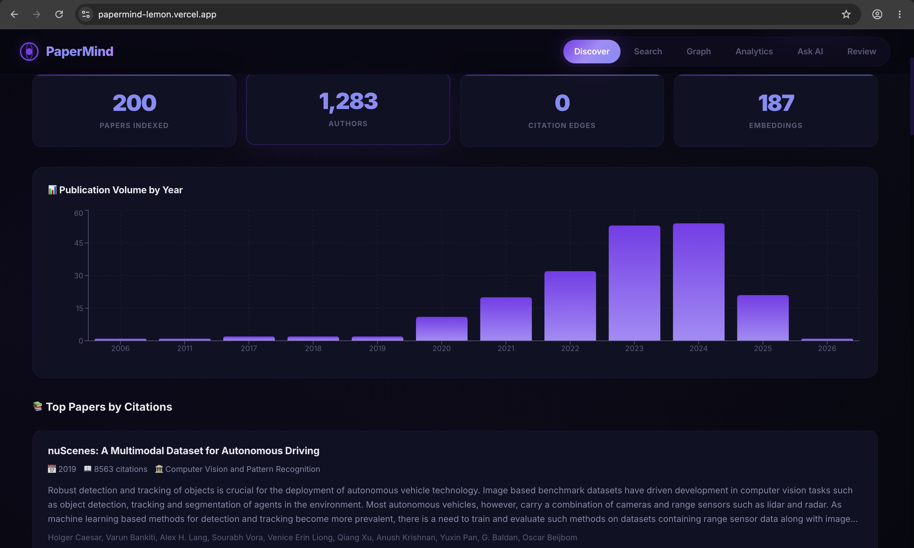
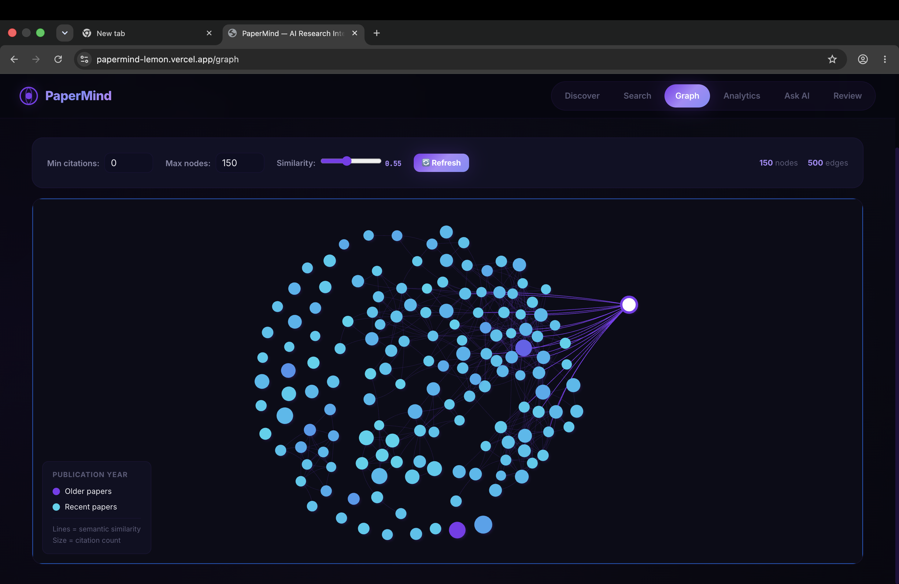
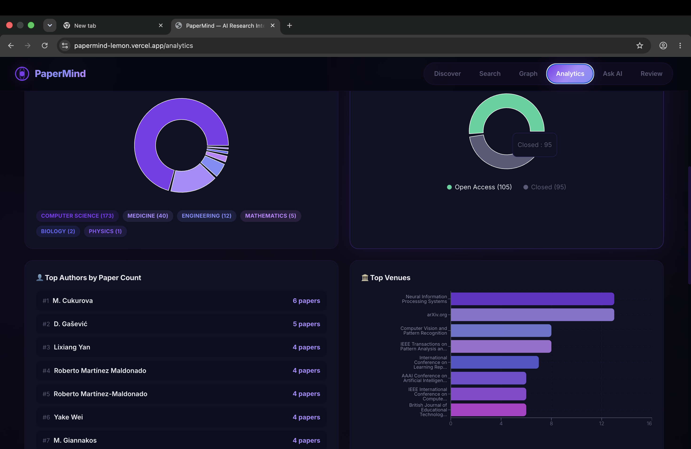

<div align="center">
  <h1>🧠 PaperMind</h1>
  <p><strong>AI-Powered Research Intelligence Platform</strong></p>
  <p>Discover, analyze, and explore academic papers using semantic search, knowledge graphs, and RAG-powered Q&A — all grounded in real papers with zero hallucination.</p>

  <p>
    
    
    
    
    
  </p>

  <h3>
    <a href="https://papermind-lemon.vercel.app" target="_blank">🌐 Try the Live Demo</a>
  </h3>
</div>

<br/>

## 📸 Screenshots

<table>
  <tr>
    <td align="center"><strong>Discover & Stats</strong></td>
    <td align="center"><strong>Knowledge Graph</strong></td>
  </tr>
  <tr>
    <td></td>
    <td></td>
  </tr>
  <tr>
    <td align="center" colspan="2"><strong>Analytics Dashboard</strong></td>
  </tr>
  <tr>
    <td colspan="2" align="center"></td>
  </tr>
</table>

---

## ✨ Features

| Feature | Description |
|---------|-------------|
| 🔍 **Semantic Search** | Search papers by meaning, not keywords — powered by sentence transformers + pgvector cosine similarity |
| 🧠 **RAG Q&A** | Ask questions about your paper collection — grounded answers citing specific papers, zero hallucination |
| 📊 **Research Analytics** | 6 interactive charts: publication trends, cumulative growth, field distribution, open access ratio, top authors, top venues |
| 🕸️ **Knowledge Graph** | Force-directed similarity network — papers with similar embeddings are connected, node size = citations, color = year |
| 📝 **Literature Reviews** | AI-generated reviews in 4 styles: comprehensive, brief overview, research gaps, and trend analysis |
| 📥 **Topic Ingestion** | Bulk-fetch papers from Semantic Scholar with one click — abstracts auto-embedded into 384-dim vectors |

---

## 🏗️ Architecture

```
┌─────────────────────────────────────────────────────────────┐
│                    Frontend (React + Vite)                   │
│  ┌──────────┐ ┌────────┐ ┌───────┐ ┌─────────┐ ┌────────┐  │
│  │ Discover │ │ Search │ │ Graph │ │Analytics│ │ Ask AI │  │
│  └────┬─────┘ └───┬────┘ └───┬───┘ └────┬────┘ └───┬────┘  │
│       └───────────┴──────────┴───────────┴──────────┘       │
│                           REST API                           │
├─────────────────────────────────────────────────────────────┤
│                   Backend (FastAPI + Python)                  │
│  ┌───────────┐  ┌──────────────┐  ┌─────────────────────┐   │
│  │ Ingestion │  │ Embedding    │  │ Q&A Service          │   │
│  │ Service   │  │ Service      │  │ (Groq LLM + RAG)    │   │
│  └─────┬─────┘  └──────┬───────┘  └─────────┬───────────┘   │
│        │               │                    │                │
│  ┌─────┴───────────────┴────────────────────┴───────────┐   │
│  │              SQLAlchemy Async ORM                      │   │
│  └───────────────────────┬───────────────────────────────┘   │
├──────────────────────────┼──────────────────────────────────┤
│                          │                                   │
│  ┌───────────────────────▼───────────────┐  ┌────────────┐  │
│  │  PostgreSQL + pgvector (Neon.tech)     │  │ Redis      │  │
│  │  • Papers, Authors, Citations          │  │ (Upstash)  │  │
│  │  • 384-dim embedding vectors           │  │            │  │
│  └───────────────────────────────────────┘  └────────────┘  │
└─────────────────────────────────────────────────────────────┘
```

---

## ⚡ Key Engineering Decisions

### 1. Similarity-Based Knowledge Graph
Traditional citation graphs require expensive API calls per paper. Instead, PaperMind computes **cosine similarity between paper embeddings** directly in PostgreSQL using pgvector's `<=>` operator, creating meaningful topic clusters with a single SQL query:
```sql
SELECT e1.paper_id, e2.paper_id, 1 - (e1.embedding <=> e2.embedding) AS similarity
FROM paper_embeddings e1 CROSS JOIN paper_embeddings e2
WHERE similarity > 0.55
```

### 2. RAG Over Hallucination
The Q&A system retrieves the top-K most relevant paper abstracts via vector similarity search, then feeds them as context to Groq's Llama 3.1. The LLM can **only** cite papers that exist in the database — no hallucinated references.

### 3. Sync Fallback for Celery
The ingestion pipeline supports both async (Celery + Redis) and synchronous execution. When Celery workers aren't available, the `/ingest` endpoint runs the full pipeline in-process — enabling single-command local development without Docker.

---

## 📦 Tech Stack

| Layer | Technology | Purpose |
|-------|-----------|---------|
| **API** | FastAPI + async SQLAlchemy 2.0 | Non-blocking REST endpoints |
| **Embeddings** | sentence-transformers `all-MiniLM-L6-v2` | 384-dim paper abstract vectors |
| **Vector Search** | pgvector | Cosine similarity inside PostgreSQL |
| **LLM** | Groq (Llama 3.1 8B) | <800ms inference for Q&A and reviews |
| **Frontend** | React 18 + Vite + Recharts + vis-network | 6-page SPA with interactive graphs |
| **Database** | Neon.tech (serverless PostgreSQL) | Free-tier cloud Postgres with pgvector |
| **Cache** | Upstash (serverless Redis) | Task queue and caching |
| **Hosting** | Render (backend) + Vercel (frontend) | $0/month deployment |

---

## 📂 Project Structure

```
papermind/
├── backend/
│   ├── app/
│   │   ├── api/              # REST route handlers
│   │   │   ├── papers.py     # Ingest, list, graph, stats
│   │   │   ├── search.py     # Semantic search + Q&A
│   │   │   └── collections.py
│   │   ├── core/             # Config + Celery
│   │   ├── db/               # SQLAlchemy models + async session
│   │   └── services/         # Business logic
│   │       ├── embeddings.py       # Sentence transformer pipeline
│   │       ├── ingestion.py        # S2 fetch → store → embed
│   │       ├── semantic_scholar.py # API client with rate limiting
│   │       └── qa.py              # RAG question answering
│   ├── tests/
│   ├── requirements.txt
│   └── .env.example
├── frontend/
│   └── src/
│       ├── pages/            # 6 React page components
│       ├── api.js            # Axios API client
│       ├── App.jsx           # Router + nav
│       └── index.css         # Design system
├── render.yaml               # Render deployment config
└── README.md
```

---

## 🔑 Environment Variables

| Variable | Description | Required |
|----------|-------------|----------|
| `DATABASE_URL` | PostgreSQL connection string (asyncpg) | ✅ |
| `REDIS_URL` | Redis/Upstash connection | ✅ |
| `GROQ_API_KEY` | Groq API key for LLM ([free](https://console.groq.com/keys)) | ✅ |
| `SEMANTIC_SCHOLAR_API_KEY` | S2 API key for higher rate limits | ❌ |
| `EMBEDDING_MODEL_NAME` | HuggingFace model ID | ❌ |

---

## 🚀 Quick Start

```bash
git clone https://github.com/AnkitKumarIISERB/papermind.git
cd papermind

# Backend
cd backend
cp .env.example .env        # Edit with your credentials
python -m venv .venv && source .venv/bin/activate
pip install -r requirements.txt
uvicorn app.main:app --reload --port 8000

# Frontend (new terminal)
cd ../frontend
npm install
npm run dev
```

Open **http://localhost:5173** → enter a research topic → click "Fetch Papers" → explore!

---

## ⚠️ Known Limitations

1. **Render Cold Starts**: Free-tier backend sleeps after 15 min of inactivity. First request takes ~30s to wake.
2. **Semantic Scholar Rate Limits**: Without an API key, limited to 100 requests/5 min. The ingestion pipeline auto-retries with backoff.
3. **CPU-Only Embeddings**: sentence-transformers runs on CPU (~0.5s per abstract). GPU would be 10x faster but isn't available on free hosting.

---

<div align="center">
  <p>Built with 💜 by Ankit</p>
</div>
